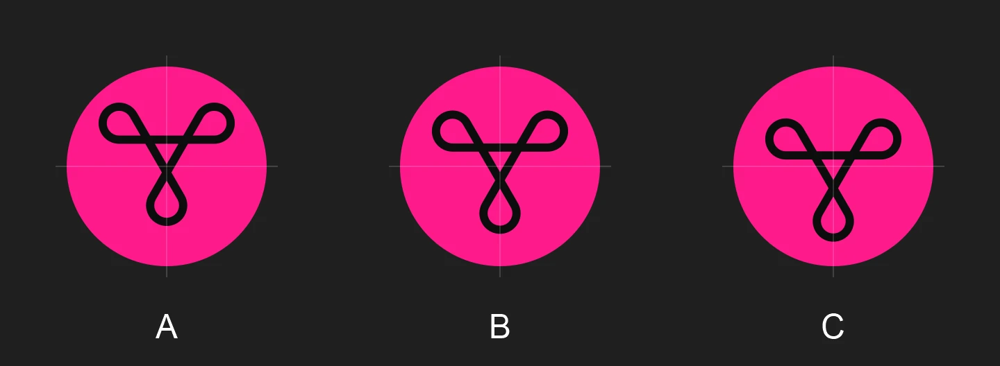

# Interview #002 — знак в круге иконки, белый текст на розовых кнопках, кнопка «Сбросить анонимный ID»

> Topic: четыре решения вкуса и приватности, которые остались после патча 8 и ваших замечаний 2026-10-16 11:54–12:00
> Source of the idea: ваши слова 2026-10-16 12:00 «иконку нашу нужно перерендерить. Сейчас не по центру круга логотип» · «а нужно по уцентру поставить»; 11:54 «предлагаю белым шрифтом текст на розовых кнопках писать»; 11:00 «ДА, принято» (кнопка сброса ID)
> Created: 2026-10-16 12:07 +03:00
> Status: ❓ waiting for the owner

## Context / что уже найдено

Патч 8 включён: приложение ходит к Tribit анонимным гостем. ID гостя, модель и Android случайные, их выбирают один раз при
установке. На A51 проверено до страницы колонки, настоящих данных телефона в запросах 0
(`testcases/reports/2026-10-16_patch8_anon.md`). Знак Tribit в иконке сдвинут: в сборке на A51 сейчас стоит вариант C ниже.

## QUESTIONS

### Q1. Где стоит знак в розовом круге иконки?
<!-- archaeology: LC_ALL=C.UTF-8 grep -rniE "стоит|знак|розов|круге|иконк" interviews/ GOAL.md MASTER_PLAN.md plans/ → 6 hits · read: GOAL.md:7,80, MASTER_PLAN.md:34, plans/02:10,11,65 · prior: unrelated — the hits are the word «стоит» in other senses and the pink colour of the mark (GOAL.md:80, HOUSE_RULES R3); none is about where the mark sits in the circle -->

**Answer target:** `patches/apply.py` → `ICON_TY` (патчи 5 и 17), `design/icon.svg`.

**Origin:** ваше замечание 12:00: знак не по центру круга.

- **B) (recommended) Середина между A и C.**
  - Ситуация: иконка Krinik Tribit на рабочем столе, лаунчер режет её кругом.
  - Действие: человек смотрит на иконку.
  - Результат: знак выглядит ровно в круге: две петли сверху и одна снизу уравновешены на глаз.
  - Проверка: в `design/icon.svg` сдвиг `translate(18.05,19.98)`; снимок иконки в лаунчере A51.
  - Почему: у знака две широкие петли наверху и одна внизу, поэтому точный центр симметрии на глаз кажется низким.
- **C) Точно по центру симметрии: все три петли на одном расстоянии от края круга.**
  - Результат: геометрически ровно; на глаз знак чуть ниже центра. Так сейчас в сборке.
- **A) Как было: по рамке вокруг знака.**
  - Результат: петли сверху почти у края круга, знак выглядит выше центра (ваше замечание).
- **D) your own answer** —

**Answer:**

### Q2. Белый текст на розовых кнопках: какой розовый?
<!-- archaeology: LC_ALL=C.UTF-8 grep -rniE "белый|текст|розов|кнопк" interviews/ GOAL.md MASTER_PLAN.md plans/ → 41 hits · read: plans/02 row «Розовые кнопки», GOAL.md 11:18, MASTER_PLAN.md 11:18 · prior: "предлагаю белым шрифтом текст на розовых кнопках писать" (chat 11:54) + "контраста текста чтобы хватало" (GOAL.md 11:18) - the measurement 3.63:1 puts the two words in conflict; the question asks how to keep both -->

**Answer target:** `plans/02` → «Розовые кнопки: текст белым»; дизайн-схема `researches/08` §6.

**Origin:** ваше предложение 11:54 «предлагаю белым шрифтом текст на розовых кнопках писать». Ваше же правило 11:18
«контраста текста чтобы хватало» берёт меру WCAG: для обычного текста — не меньше 4,5:1. Замер: белый на нашем `#FF1A8C`
— 3,63:1, чёрный на нём — 5,78:1.

- **A) (recommended) Белый текст, а сами кнопки чуть глубже розовые — `#E0137E`.**
  - Ситуация: экран настроек колонки, внизу розовая кнопка «Выключение».
  - Действие: человек смотрит на кнопку при дневном свете.
  - Результат: белая надпись на розовом читается, контраст 4,60:1; розовый остаётся розовым, только на кнопках на тон глубже.
  - Проверка: скрипт контраста печатает `4.60` для `#FFFFFF` на `#E0137E`; макет кнопки рядом с нынешней.
- **B) Белый текст на нашем `#FF1A8C`, но надпись на кнопках крупнее и жирнее (от 19 px жирным).**
  - Результат: цвет кнопок тот же; крупному жирному тексту по WCAG хватает 3:1, у нас 3,63:1.
- **C) Белый текст на `#FF1A8C` как есть.**
  - Результат: проще всего; контраст 3,63:1 — меньше 4,5:1 из вашего правила о контрасте.
- **D) your own answer** —

**Answer:**

### Q3. Что сбрасывает кнопка «Сбросить анонимный ID»?
<!-- archaeology: LC_ALL=C.UTF-8 grep -rniE "сбрасыва|кнопк|сброси|анонимн" interviews/ GOAL.md MASTER_PLAN.md plans/ → 29 hits · read: MASTER_PLAN.md 10:59 and 11:00, plans/01 §4б · prior: "ДА, принято" 11:00 - the button exists; what it resets - not decided -->

**Answer target:** `patches/java/krinik/Anon.java` → `reset()`; `plans/01` §4б, пункт 1.

**Origin:** решение 11:00 «ДА, принято»: ID гостя случайный на установку, плюс кнопка сброса.

- **A) (recommended) Всё сразу: ID гостя, модель и версию Android.**
  - Ситуация: человек пользуется Krinik Tribit месяц, Tribit видит одного и того же гостя «Infinix X6836, Android 16».
  - Действие: он жмёт «Сбросить анонимный ID» в настройках приложения.
  - Результат: для Tribit это новый человек с новым ID и другим телефоном; связать его со старым гостем нельзя.
  - Проверка: `python -I testcases/anon_check.py` на журнале до и после сброса — `emailAccount` и `logMobModel` разные.
  - Почему: если сменить только ID, а телефон оставить, редкая модель всё равно связывает старого и нового гостя.
- **B) Только ID гостя.**
  - Результат: модель и Android остаются прежними.
- **C) Кнопка не нужна: нужен новый гость — переустанови приложение.**
  - Результат: меньше кода; сбросить гостя без переустановки нельзя.
- **D) your own answer** —

**Answer:**

### Q4. Сколько символов можно в имени колонки и в имени эквалайзера?
<!-- archaeology: LC_ALL=C.UTF-8 grep -rniE "предел|длин|символ|имя" interviews/ GOAL.md MASTER_PLAN.md plans/ → 15 hits · read: plans/02:68, MASTER_PLAN.md:89,91, GOAL.md:52, plans/01:79,129 · prior: "ограничивать в поле ввода название длинной не более чем x симовлов, подумать, сколько хватит" (chat 11:44, plans/02:68) - the number itself not decided; the other hits are about phone fields and screen size -->

**Answer target:** `plans/02` → «Поле ввода имени: предел длины».

**Origin:** ваше замечание 11:44 «ограничивать в поле ввода название длинной не более чем x симовлов, подумать, сколько
хватит». Найдено в их коде: предел уже есть. Имя колонки — до **25** символов (окно «Изменить имя устройства», счётчик
«12/25»), имя эквалайзера — до **15** («0/15» в окне нового эквалайзера). После патча 24 имя на карточке переносится до
трёх строк: «Tribit StormBox Blast 2» (23 символа) занимает две.

- **A) (recommended) Оставить 25 и 15, а длинное имя переносить, а не резать — на карточках (уже сделано) и в строках
  настроек (следующий шаг).**
  - Ситуация: человек назвал колонку «Колонка на кухне у бабушки» (25 символов).
  - Действие: он открывает главный экран и настройки колонки.
  - Результат: имя видно целиком: на карточке в две строки, в настройках второй строкой под «Имя устройства».
  - Проверка: снимки A51 главного экрана и настроек с именем из 25 символов, ни одного «…».
- **B) Имя колонки до 20 символов, эквалайзера — до 15.**
  - Результат: имя чаще влезает в одну-две строки; заводское имя «Tribit StormBox Blast 2» (23 символа) после
    переименования уже не ввести.
- **C) Другое число** — напишите какое.
- **D) your own answer** —

**Answer:**

## Proposed implementation plan (after answers)

1. Q1 → `ICON_TY` и `design/icon.svg` по выбранному варианту; сборка; снимок иконки в лаунчере A51.
2. Q2 → цвет и размер надписи розовых кнопок в одном месте дизайн-схемы; макет «до / после»; снимки экранов с кнопками.
3. Q3 → `Anon.reset()` по ответу и сброс гостевого токена; кнопка в настройках приложения; прогон `anon_check.py`.
