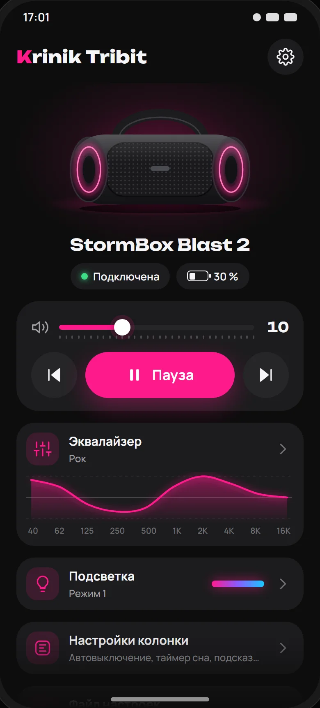
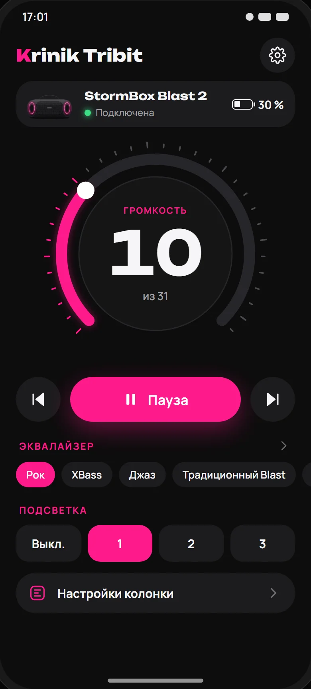
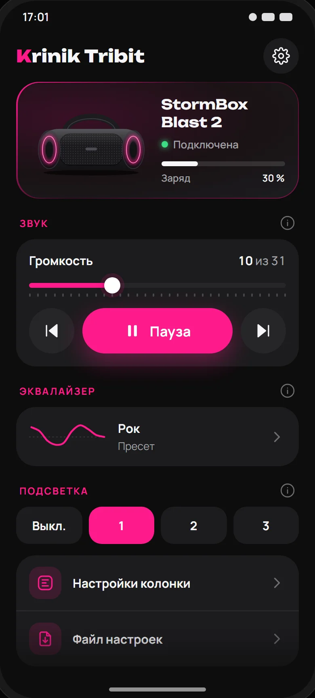
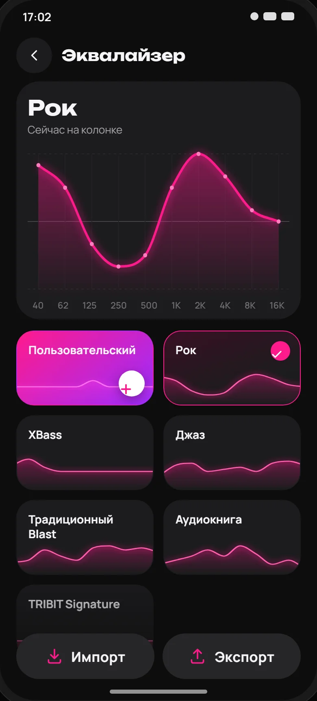
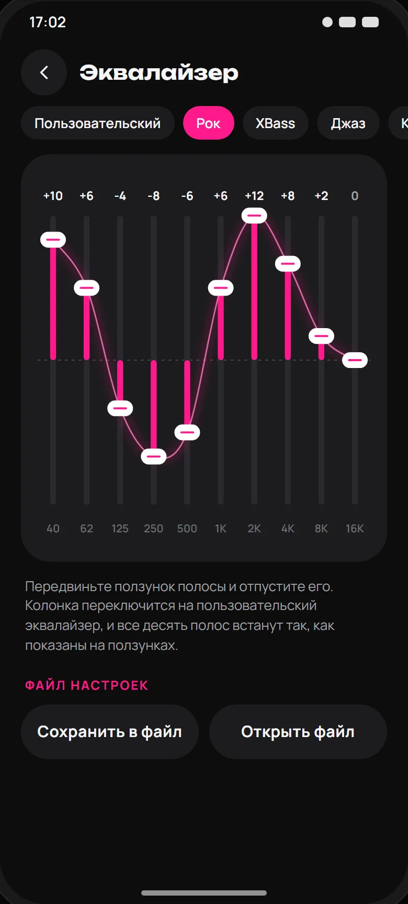
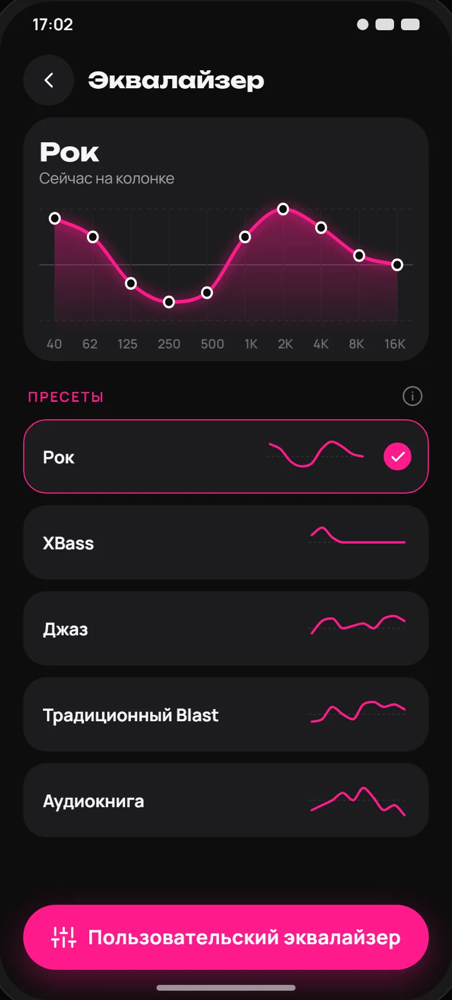

# Interview #003 — какой главный экран и какой эквалайзер у Krinik Tribit

> Topic: выбор вида главного экрана и экрана эквалайзера своего приложения из трёх вариантов (лист макетов 1)
> Source of the idea: ваши слова 2026-10-16 ≈ 19:1x +03:00 «давай макеты сверстаем» · «Ориентируемся на оригинальное приложение Tribit, но делаем ПО-СВОЕМУ, КРСИВО, ПЕРЕОСМЫСЛИВАЕМ!»
> Created: 2026-10-16 19:19 +03:00
> Status: ❓ waiting for the owner

## Context / что уже найдено

Лист макетов — `design/mockups-v1.html`, снимки — `design/mockups-v1/`. Данные у всех вариантов одни: колонка Tribit
StormBox Blast 2 подключена, заряд 30 %, громкость 10 из 31, колонка играет, эквалайзер «Рок», подсветка — режим 1.
Образец — экраны приложения Tribit 5.0.0 (фото колонки, плеер, карточки звуковых эффектов, график эквалайзера) и
дизайн-схема KARTUN (розовые подписи разделов, карточка с розовой рамкой, иконки, кнопка (i)).

Факты, на которых стоят макеты:
- кривые пресетов — полосы из таблицы приложения Tribit (`app/.../protocol/Eq.kt`); у TRIBIT Signature, Классики,
  Концерта и Подкаста все десять полос стоят на 0 дБ;
- колонка нарисована для Krinik Tribit, фото и картинки приложения Tribit не используются;
- кнопки «Назад» и «Вперёд» по трекам: команда есть в протоколе колонки, в приложении этих кнопок пока нет.

Рекомендации нет: вид экрана — выбор вашего вкуса (`AGENT_GUIDE.md` → The taste class). Главный экран и эквалайзер
можно взять из разных вариантов.

## QUESTIONS

### Q1. Какой главный экран?
<!-- archaeology: search "главн|экран|вариа|макет|эквалайз" → 102 hits · read: interviews/interview_001, interview_002 (Q1 icon, Q2 pink buttons, Q4 name limits), MASTER_PLAN.md 11:16, 11:18, 11:19 · prior: unrelated — interview_002 decided the icon and the white text on pink buttons (both kept in every variant); no prior choice of a screen layout -->
<!-- questions-guard:vocabulary-ok taste class: the options are pictures, the names A/B/C are the sheet's labels -->

  

**Answer target:** `app/src/main/kotlin/com/kriniks/tribit/ui/` (главный экран), дизайн-схема фазы 3 `plans/04`.

- **A) Сцена.** Большая колонка в центре на розовом свете, под ней имя, «Подключена» и заряд, ниже карточка плеера
  (назад, большая розовая «Пауза», вперёд, ползунок громкости) и четыре плитки: Эквалайзер, Подсветка, Настройки колонки,
  Файл настроек.
  - Ситуация: колонка подключена, играет музыка, громкость 10 из 31.
  - Действие: человек открывает Krinik Tribit.
  - Результат: первой видна нарисованная колонка; громкость и пауза — в карточке под ней; разделы — плитками.
  - Проверка: снимок `design/mockups-v1/A-home.webp`; после сборки — снимок экрана A51 рядом с макетом.
- **B) Пульт.** Сверху строка колонки с зарядом, в центре круглая ручка громкости с цифрой 10, под ней «Пауза» и кнопки
  треков; пресеты эквалайзера строкой и режимы подсветки переключаются прямо на главном экране.
  - Ситуация: колонка подключена, играет музыка, громкость 10 из 31.
  - Действие: человек открывает Krinik Tribit.
  - Результат: первой видна ручка громкости; пресет и подсветка меняются одним нажатием без перехода на другой экран.
  - Проверка: снимок `design/mockups-v1/B-home.webp`.
- **C) Карточки.** Карточка колонки с розовой рамкой (рисунок, «Подключена», полоска заряда), разделы «Звук»,
  «Эквалайзер», «Подсветка» под розовыми подписями с кнопкой (i), внизу строки Настройки колонки и Файл настроек.
  - Ситуация: колонка подключена, играет музыка, громкость 10 из 31.
  - Действие: человек открывает Krinik Tribit.
  - Результат: экран собран как KARTUN: всё на одной странице разделами, у каждого раздела пояснение по кнопке (i).
  - Проверка: снимок `design/mockups-v1/C-home.webp`.
- **D) your own answer** — например, смесь: «A, но пресеты строкой из B».

**Answer:**

### Q2. Какой экран эквалайзера?
<!-- archaeology: search "главн|экран|вариа|макет|эквалайз" → 102 hits · read: interview_002 Q4 (EQ name up to 15 chars), plans/06 (EQ phase 2) · prior: unrelated — no prior choice of the EQ screen layout -->
<!-- questions-guard:vocabulary-ok taste class: the options are pictures, the names A/B/C are the sheet's labels -->

  

**Answer target:** `app/src/main/kotlin/com/kriniks/tribit/ui/EqScreen.kt`.

- **A) Сцена.** Вкладки «Пресеты» и «Пользовательский»; сверху большой график кривой «Рок» с точками на десяти полосах,
  ниже пресеты карточками в две колонки, на каждой карточке нарисована кривая этого пресета.
  - Ситуация: на колонке стоит «Рок».
  - Действие: человек открывает эквалайзер.
  - Результат: график показывает кривую «Рок», карточка «Рок» в розовой рамке с галочкой.
  - Проверка: снимок `design/mockups-v1/A-eq.webp`.
- **B) Пульт.** Пресеты строкой сверху, под ними десять вертикальных фейдеров, как на микшерном пульте, с цифрой дБ над
  каждым; ниже пояснение и кнопки «Сохранить в файл», «Открыть файл».
  - Ситуация: на колонке стоит «Рок».
  - Действие: человек открывает эквалайзер и двигает фейдер 1K.
  - Результат: фейдеры показывают полосы «Рок»; после движения фейдера колонка переходит на пользовательский эквалайзер.
  - Проверка: снимок `design/mockups-v1/B-eq.webp`.
- **C) Карточки.** Сверху карточка «Сейчас на колонке» с кривой, ниже список пресетов строками (имя и маленькая кривая,
  выбранный в розовой рамке с галочкой), внизу розовая кнопка «Пользовательский эквалайзер».
  - Ситуация: на колонке стоит «Рок».
  - Действие: человек открывает эквалайзер.
  - Результат: строка «Рок» в розовой рамке; пользовательский эквалайзер открывается розовой кнопкой внизу.
  - Проверка: снимок `design/mockups-v1/C-eq.webp`.
- **D) your own answer** —

**Answer:**
